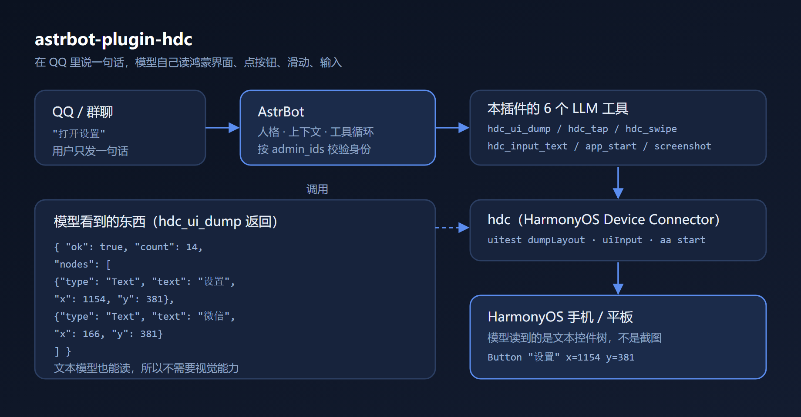

# astrbot-plugin-hdc

让 AstrBot 通过 `hdc` 操控一台 HarmonyOS 设备（鸿蒙手机 / 平板）。

给机器人装上这个插件之后，就可以在 QQ 里直接说「打开设置」「看看屏幕上有什么」，
由模型自己读界面、点按钮、滑动、输入文字。



## 它解决什么问题

市面上的手机自动化方案基本都只覆盖 Android（adb、scrcpy）。鸿蒙用的是 **hdc**
（HarmonyOS Device Connector），工具链完全不同，现有插件都用不了。

这个插件把 hdc 的几个能力包成了 LLM 工具：

| 工具 | 作用 |
| --- | --- |
| `hdc_ui_dump` | 读当前界面的控件树（文字 + 坐标） |
| `hdc_see` | 截图并把画面交给模型看（视觉兜底） |
| `hdc_tap` | 点击坐标 |
| `hdc_swipe` | 滑动 |
| `hdc_input_text` | 输入文字 |
| `hdc_app_start` | 按 bundle 名启动应用 |
| `hdc_screenshot` | 截图存盘（给人看 / 稍后发出去） |

## 两条路径：控件树优先，视觉兜底

`hdc_ui_dump` 能覆盖绝大多数场景——按钮有文字、列表有标题，文本就够用了，
而且几乎不花 token。

但有些界面是**自绘**的：抖音信息流、游戏画面、图片墙。这些界面在控件树里
几乎是空的，只能看到点赞数这类零散文本，读不出画面内容。

所以插件做了分工：

- `hdc_ui_dump` 返回的节点少于 5 个时，会带一个 `hint`，提示模型改用 `hdc_see`
- `hdc_see` 截图后把图片直接交给模型（走 `ImageContent`），模型能真的"看见"

**能读文本就别截图**：一张图大约 1000~3000 token，比读控件树贵 5~10 倍。
把它当兜底，而不是默认。

## 截图不会越存越多

截图固定保留最近 20 张（`shot-1.jpeg` 最新，依次后移），并且**先缩到 720 宽**
再存——一张约 100 KB，总共 2 MB 左右，长期运行也不会涨。

## 为什么用控件树而不是截图

用 `uitest dumpLayout` 读出来的是一棵**文本**控件树：

```
Button "微信"  x=166 y=381
Button "设置"  x=1154 y=381
```

文本模型能直接读它，所以**纯文本模型也能操作手机**，不需要视觉能力。
截图只是留给人确认，不作为模型输入。

## 安装

1. 把本目录放到 AstrBot 的 `data/plugins/astrbot_plugin_hdc/`
2. 重启 AstrBot
3. 在 WebUI 的插件配置里填 `admin_ids`（允许操控设备的 QQ 号）

### 前提条件

- 设备已开启「开发者选项 → USB 调试」
- 电脑上有 `hdc`（DevEco Studio 自带，或单独装 HarmonyOS SDK）
- `hdc list targets` 能看到设备

插件会按这个顺序找 hdc：插件配置 → `PATH` → DevEco Studio 常见安装位置。

## 配置项

| 键 | 说明 |
| --- | --- |
| `hdc_path` | hdc 路径。留空则自动查找 |
| `target` | 设备地址，如 `192.168.1.5:39199`。留空则自动取第一台 |
| `admin_ids` | 允许操控设备的 QQ 号。留空则用 AstrBot 全局管理员 |
| `timeout` | 单次 hdc 命令超时秒数，默认 25 |
| `screenshot_dir` | 截图保存目录。留空则用系统临时目录 |

## 安全边界

这个插件让一个 LLM 直接操作真实设备，所以内置了几道限制：

- **只有 `admin_ids` 里的 QQ 号能触发**，其他人调用一律拒绝
- **支付 / 银行类应用在黑名单里**，`hdc_app_start` 会拒绝启动它们
- 每条 hdc 命令都有超时，设备卡住不会拖死对话

**请自行评估风险**：模型的行为不完全可预测，不要把它接到你不介意被乱点的设备上。
涉及付款、转账、删除数据的操作，不要交给它。

## 实现上的两个坑

给后来人省点时间：

**1. `aa start` 失败也会返回成功**

```bash
hdc shell aa start -a EntryAbility -b com.example.app
# start ability successfully.   <- 但 ability 根本不存在
```

所以插件在启动前会先 `bm dump -n <bundle>` 核对 ability 名，对不上就自动探测。

**2. ability 名有两种写法**

| 应用 | ability 名 |
| --- | --- |
| 系统设置 | `com.huawei.hmos.settings.MainAbility` |
| 抖音 | `MainAbility` |

有的名字自带包名前缀，有的就是裸名，而 `aa start -a` 必须收到清单里的原名。
插件直接照抄清单里的名字，不拼前缀。

## 兼容性

- 在 HarmonyOS 6（API 26）的 SGT-AL10 上验证通过
- `uitest` 与 `aa`、`bm` 属于系统命令，不同鸿蒙版本的输出格式可能有差异

## 许可

MIT
